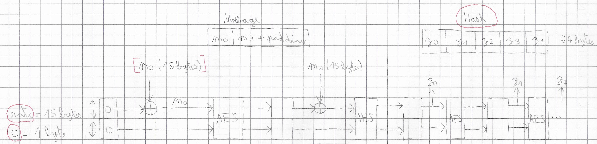
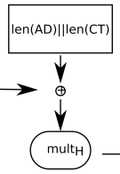
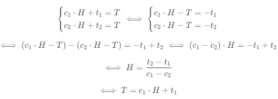
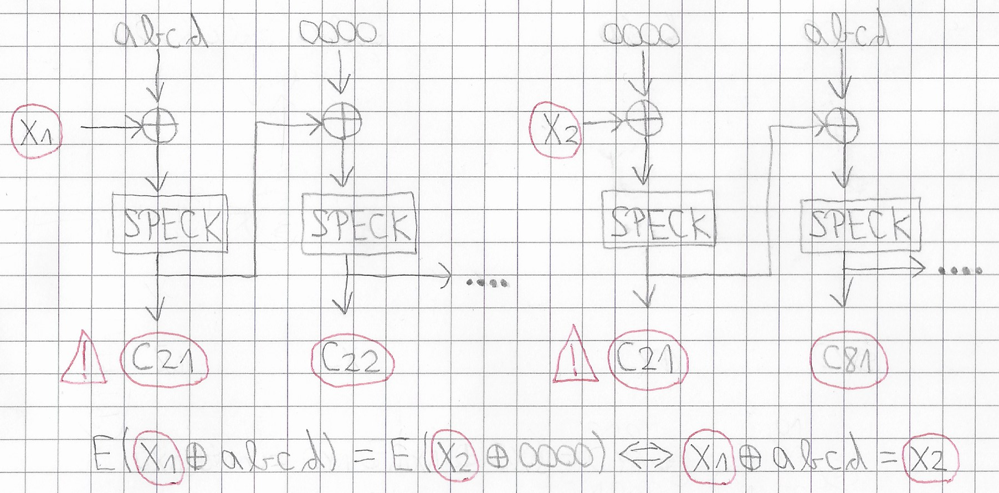

# CRY Labo 2

## 1. Spongy AES

### 1.1. Schéma de la construction

### 1.2. Récupération du message

Pour commencer, il faut revenir à la phase d'absorption. Pour cela, je récupère `z0` (15 premiers bytes du hash),
je le concatène avec une possibilité du caractère `c` (16ème byte) à la fois en bruteforçant les caractères ASCII de 33
à 126 puis je chiffre le tout. Si le résultat du chiffrement (sans le 16ème byte) correspond à `z1` (15 bytes suivants
du hash), je sais que j'ai trouvé le bon caractère `c`. Ainsi, je peux revenir à la phase d'absorption en déchiffrant
`z0` concaténé avec le bon caractère `c`.

Maintenant dans la phase d'absorption, je sais que les blocs ont une taille de 15 bytes et que le message a une taille
de 19 bytes, cela veut dire que le deuxième bloc contient 4 bytes du message et 11 bytes de padding. Je connais le
dernier caractère du message, qui est une `}` ainsi que le padding, donné dans la fonction `pad()`, cela signifie qu'il
ne me reste plus qu'à trouver les 3 premiers bytes du deuxième bloc. Pour cela, je les bruteforce en utilisant
uniquement les caractères ASCII de 33 à 126.

Je fais un xor du résultat du déchiffrement de `z0` et `c` avec les caractères bruteforcés concaténés avec l'
`}` et le padding, puis je déchiffre le tout avec `c`. Enfin pour trouver le message complet, il me suffit de comparer
les 5 premiers bytes du résultat avec le début du message que je connais qui est `FLAG{`, s'ils sont égaux, je sais
que j'ai trouvé la bonne combinaison de caractères avec le bruteforce et donc le bon message.

- Message trouvé : `FLAG{familiarizing}`

## 2. GCM

### 2.1. Erreur d'implémentation

L'erreur d'implémentation est que la partie xor de `multH` avec `len(AD)||len(CT)` n'est pas effectuée.

### 2.2. Déchiffrement GCM

La fonction de déchiffrement GCM est implémentée sous le nom de `GCM_decrypt` et a été testée dans la fonction
`test_GCM_decrypt()`.

### 2.3. Textes chiffrés fournis

Ce qui est étrange, c'est que les textes chiffrés fournis utilisent le même IV.

### 2.4. Récupération du 2ème texte clair

Je sais que les deux textes chiffrés utilisent le même IV, donc si je fais un xor entre `m1` (premier texte clair)
et `c1` (premier texte chiffré) j'obtiens `ek` (IV et compteur chiffrés avec la clé k) qui est le même pour les deux
textes. Ainsi, pour trouver le deuxième texte clair, il suffit de faire un xor entre `ek` et `c2` (deuxième texte
chiffré).

- Deuxième texte clair : `Pass = buffering`

### 2.5. Cassage de l'intégrité

Grâce à l'exercice précédent, je sais que `ek` est le même pour les deux textes, je vais donc, pour cet exercice
réutiliser le même IV. Ainsi, pour trouver le texte chiffré de `mChall`, il suffit de faire un xor entre `ek` et
`mChall`.

Ensuite, pour générer un tag valide, il faut trouver `H` et `T`. En sachant que je connais `c1`, `c2`, `t1`, `t2` et que
les IVs sont les mêmes, je pose mathématiquement le problème et j'obtiens une équation à deux inconnues :

> *Les xor sont remplacés par des additions dans GF(2^128)*

Maintenant que j'ai trouvé `H` et `T`, je peux générer un tag valide. Pour cela, je multiplie `cx` (texte chiffré
correspondant à `mChall`) par `H` et je xor le tout avec `T`.

Résultat :

- IV (le même) : `NuIpy3Lh/Ldy7Mu8`
- Nouveau texte chiffré : `ItjuItWni4QEPq7wX31RAw==`
- Nouveau tag : `E5RvnNjDxWdZ41JTtxPgoQ==`

## 3. Speck

### 3.1. Récupération du mot de passe avec la clé

Étant donné que la séquence mot de passe, zéros se répète, il suffit de déchiffrer un bloc aléatoire autre que le
premier (car il est xor avec l'IV qu'on ne connaît pas). Si le résultat du déchiffrement donne le même bloc que le bloc
précédent, c'est qu'on est tombé sur un bloc qui a été xor avec les 4 bytes à 0, il faut donc déchiffrer le bloc
suivant ou précédent (à condition que le précédent ne soit pas le premier bloc). Une fois le bloc déchiffré, il suffit
de faire un xor avec le bloc précédent pour trouver le mot de passe.

### 3.2. Récupération du mot de passe sans la clé

Je sais que la séquence mot de passe, zéros se répète et qu'elle est très longue, il y aura donc forcément un moment où
des blocs de texte chiffré se répèteront. Ainsi, je commence par chercher des blocs de texte chiffré qui se répètent. En
effet, une répétition indiquerait que le même état est entré dans le chiffreur Speck et me permettrait de trouver le mot
de passe, notamment grâce à mon schéma ci-dessous.

On peut voir que si je trouve deux blocs de texte chiffré identiques dont un en position paire et l'autre en position
impaire, je peux appliquer la formule au bas de l'image pour trouver le mot de passe. Or, dans cet exercice, j'ai trouvé
4 blocs qui se répètent et pour chacun d'entre eux, l'un était en position paire et l'autre en position impaire. J'ai
donc appliqué ma formule sur chacun d'eux et ils m'ont tous donné le même mot de passe.

- Mot de passe : `nrUe`

### 3.3. Fonctionnement sur AES-CBC

Cette attaque ne fonctionne pas sur AES-CBC. En effet, la formule utilisée pour trouver le mot de passe ne serait plus
applicable parce qu'un bloc AES à une taille de 16 bytes et contiendrait donc les deux parties de la séquence. Et même
si nous changions la longueur du mot de passe et celle des zeros à 16 bytes (pour que chaque partie prenne tout le
bloc), une telle taille de bloc engendrerait une probabilité quasiment nulle de trouver deux blocs identiques.